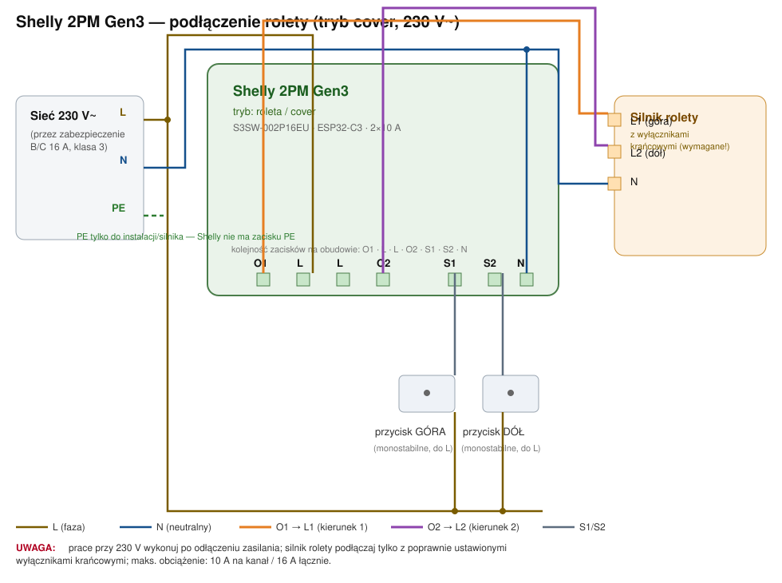
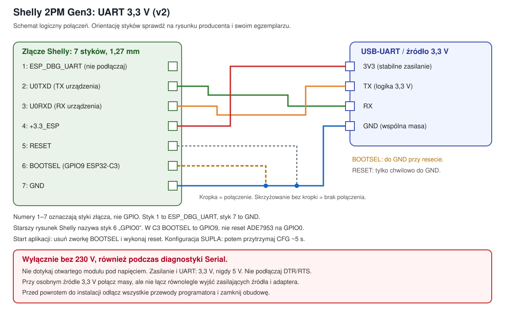

# Shelly 2PM Gen3 → SUPLA: sterowanie roletą

**Aktualny wariant: własny firmware v2 na SuplaDevice.**
Kompilacja sprawdzona, testy na fizycznym Shelly pozostają do wykonania.
Nie jest to potwierdzona na sprzęcie wersja produkcyjna.

**Data:** 2026-10-11 · **Stan i historia:** [STATUS.md](STATUS.md)

## 1. Zakres projektu

Shelly 2PM Gen3 (S3SW-002P16EU, ESP32-C3, 8 MB) steruje jedną zwykłą roletą:

- góra, dół, stop i pozycja procentowa przez SUPLA;
- przyciski ścienne, działające lokalnie również bez internetu;
- wybór **MONOSTABLE / BISTABLE** dla obu wejść w panelu WWW;
- **ręczne wejście w konfigurację**, bez automatycznego AP po pierwszym wgraniu;
- **czasy przejazdu ustawiane w konfiguracji kanału SUPLA**;
- odwracanie kierunku napędu i przycisków przez konfigurację kanału.

Nie dodajemy pomiaru energii, temperatury, OTA ani automatycznego pomiaru
czasów. Pomiar energii nie jest potrzebny do sterowania czasowego roletą.

## 2. Bezpieczeństwo

- Montaż 230 V i kontrolę braku napięcia powinien wykonać elektryk.
- **UART/programator można podłączyć wyłącznie po całkowitym odłączeniu
  urządzenia od instalacji 230 V. Dotyczy to również diagnostyki Serial.**
  Interfejs serwisowy nie jest bezpiecznym, izolowanym portem przy zasilaniu sieciowym.
- Zasilanie i poziomy logiczne UART muszą wynosić **3,3 V**, nigdy 5 V.
  Sama zworka wyboru napięcia na adapterze nie zawsze zmienia poziom jego TX.
- Przed powrotem do instalacji odłącz wszystkie przewody programatora
  i zamknij obudowę. Nie dotykaj płytki ani wewnętrznego przycisku przy 230 V.
- Silnik musi mieć prawidłowo ustawione krańcówki i wymagane przez producenta
  zabezpieczenia. PE prowadzi się do silnika zgodnie z jego klasą ochronności,
  nie przez Shelly, które nie ma zacisku PE.
- Ten firmware **nie odtwarza programowych zabezpieczeń Shelly opartych
  na temperaturze/prądzie ani wykrywania przeszkód**. Zabezpieczenia napędu
  i ochrona elektroniki modułu to różne rzeczy.
- Po zmianie firmware nie należy zakładać zachowania fabrycznej funkcjonalności
  i deklarowanych właściwości ochronnych. Wpływ modyfikacji na gwarancję
  zależy od jej warunków i właściwych przepisów.

## 3. Co przygotować

| Element | Uwagi |
|---|---|
| Shelly 2PM Gen3 | sprawdź model, nie stosuj mapy do Plus 2PM, 2.5 ani Gen4 |
| USB-UART 3,3 V | RX, TX, GND; nie podłączamy DTR/RTS |
| Stabilne źródło 3,3 V | do pracy Wi-Fi zalecane co najmniej 500 mA; wyjście adaptera może być za słabe |
| Złącze/przewody rastra 1,27 mm | 7-stykowy interfejs serwisowy; styki muszą być pewne |
| Zworka BOOTSEL | między stykiem 6 i GND; identyfikacja poniżej |
| Multimetr i narzędzia | identyfikacja połączeń tylko bez napięcia |
| Komputer | sprawdzone: arduino-cli 1.3.1, esp32:esp32 3.3.3, SuplaDevice 26.8 |
| Konto SUPLA Cloud | czasowo włączona rejestracja nowych urządzeń przy pierwszym dodawaniu |

Przy osobnym zasilaniu 3,3 V połącz jego GND z GND adaptera, ale nie łącz
równolegle wyjść zasilających dwóch źródeł. Izolator USB nie zastępuje
odłączenia Shelly od instalacji sieciowej.

## 4. Podłączenie rolety



Schemat jest ideowy. Kieruj się oznaczeniami zacisków swojego egzemplarza,
nie samą orientacją rysunku: **O1 · L · L · O2 · S1 · S2 · N**.

| Zacisk | Połączenie w instalacji 230 V AC |
|---|---|
| O1, O2 | dwa osobne przewody kierunkowe silnika |
| L | faza zasilania; oba zaciski L są połączone wewnętrznie |
| N | przewód neutralny zasilania; neutralny silnika do tej samej sieci N |
| S1, S2 | wejścia łączników ściennych zwieranych do L |
| PE | poza modułem, do silnika zgodnie z instrukcją napędu |

1. Ustaw krańcówki według instrukcji napędu.
2. Przy odłączonym zasilaniu wykonaj połączenia i zamknij obudowę.
3. Dopiero po odłączeniu programatora można uruchomić zasilanie sieciowe.
4. Sprawdź kierunki krótkimi poleceniami i funkcję STOP.
5. Ustaw czasy pełnego przejazdu w SUPLA, następnie ustal pozycję odniesienia.

Producent podaje 10 A na kanał i 16 A łącznie. Nie jest to automatycznie
dopuszczalny prąd każdego silnika, trzeba uwzględnić prąd rozruchowy i zalecenia
dla obciążeń indukcyjnych. Biblioteka steruje jednym kierunkiem naraz
i stosuje przerwę przy zmianie kierunku; nie jest to sprzętowa blokada przekaźników.

Ten projekt dotyczy silnika kierunkowego **230 V AC**. Nie opisuje sterowania
silnikami DC przez zmianę polaryzacji ani ich połączeń.

## 5. GPIO i złącze programowania

Mapa programu v2 pozostaje taka jak w v1. **Przypisanie fizycznych O1/O2
i S1/S2 oraz kierunków trzeba potwierdzić na egzemplarzu.** Tabela GPIO
i przykład YAML w źródle ESPHome różnią się numeracją kanałów;
nie zmieniamy pinów w istniejącym firmware na podstawie samej nazwy kanału.

| GPIO | Użycie w programie |
|---|---|
| 3, 5 | przekaźniki: odpowiednio kierunek góra/dół, aktywne HIGH |
| 10, 18 | wejścia IN1/IN2, domyślnie aktywne HIGH |
| 2 | LED statusu, aktywna LOW |
| 19 | przycisk CFG, aktywny LOW z pull-up |
| 0, 1, 6, 7 | ADE7953: reset, IRQ, SDA, SCL; nieużywane przez ten firmware |
| 4 | wejście temperatury, nieużywane |
| 9 | BOOTSEL ESP32-C3, tylko do wejścia w bootloader |
| 20, 21 | UART0: RX/TX |

**Styki interfejsu serwisowego, według numeracji rysunku Shelly:**

| Styk | Sygnał | Połączenie |
|---|---|---|
| 1 | ESP_DBG_UART | nie podłączaj |
| 2 | U0TXD | RX adaptera |
| 3 | U0RXD | TX adaptera |
| 4 | +3.3_ESP | stabilne 3,3 V |
| 5 | RESET | opcjonalnie chwilowo do GND |
| 6 | BOOTSEL | do GND podczas resetu/włączenia zasilania |
| 7 | GND | GND adaptera i źródła zasilania |

**Styk 6 jest opisany jako „GPIO0” na starszym rysunku interfejsu Shelly,
ale BOOTSEL w ESP32-C3 to GPIO9.** Nie zwieraj zamiast niego GPIO0 procesora,
które w Gen3 obsługuje reset licznika. Numery styków 1–7 nie są numerami GPIO.
Pin 1 znajduje się od strony **ESP_DBG_UART**, nie GND.
Orientację porównaj z [rysunkiem producenta](https://kb.shelly.cloud/knowledge-base/shelly-2pm-gen3).



Stary `02-zlacze-programowania.svg` pozostawiono wyłącznie jako historię,
nie jako instrukcję połączeń.

## 6. Flashowanie i aktualizacja

Pełna procedura: **[docs/flashowanie.md](docs/flashowanie.md)**.

| Operacja | Obraz i sposób zapisu |
|---|---|
| Pierwsze przejście z Shelly na SUPLA | po pełnym backupie: `shelly2pmg3_roleta_v2.ino.merged.bin` od `0x0`; usuwa dotychczasową zawartość flash |
| Aktualizacja v1/v2 wariantu A, z zachowaniem ustawień | tylko `shelly2pmg3_roleta_v2.ino.bin` od `0x10000`, bez pełnego kasowania, przy zgodnym układzie partycji i aktywnym app0 |
| Powrót do Shelly | pełna kopia tego egzemplarza od `0x0`; odtwarza stan z chwili kopii |

**Nie używaj `merged.bin` jako zwykłej aktualizacji.** Nadpisuje również
konfigurację Wi-Fi, GUID/AuthKey i zapisany stan. Nie wykonuj `erase-flash`
przy aktualizacji zachowującej ustawienia.

## 7. Firmware v2 i kompilacja

Źródło: [`firmware/shelly2pmg3_roleta_v2/shelly2pmg3_roleta_v2.ino`](firmware/shelly2pmg3_roleta_v2/shelly2pmg3_roleta_v2.ino).
Historyczna v1 pozostaje w `firmware/shelly2pmg3_roleta/`.
Szkice są w osobnych katalogach, aby Arduino nie kompilowało dwóch `setup()` naraz.

```bash
PROJECT="/Users/serwerhome/Projects/supla-esp32-base/projects/wip/shelly-2pmg3-rolety-supla"
"$HOME/.local/bin/arduino-cli" compile --jobs 4 \
  --fqbn "esp32:esp32:esp32c3:FlashSize=8M,PartitionScheme=default_8MB" \
  --output-dir "$PROJECT/firmware/build/v2" \
  "$PROJECT/firmware/shelly2pmg3_roleta_v2"
```

Zweryfikowany wynik v2: **1 410 842 B (42%)** pamięci programu,
**39 288 B (11%)** RAM. Wersja zgłaszana przez firmware: `shelly2pmg3-v2`.

| Flaga | Domyślnie | Znaczenie |
|---|---|---|
| `SHELLY_BUTTONS_MONOSTABLE` | `1` | domyślny typ nowych ustawień; istniejące ustawienie WWW ma pierwszeństwo |
| `SHELLY_SW_ACTIVE_HIGH` | `1` | polaryzacja wejść; nie jest odwróceniem kierunku góra/dół |
| `SHELLY_HAS_WALL_BUTTONS` | `1` | `0` wyłącza obsługę przycisków ściennych |
| `SHELLY_TILT_FUNCTIONS` | `0` | dla zwykłej rolety pozostaw `0`; zmiana wpływa na format zapisu stanu |
| `SHELLY_DEBUG_IO` | `0` | Serial 115200 do diagnostyki na stole, wyłącznie bez 230 V |

W v2 nie zmieniono kolejności kanałów/przycisków ani układu partycji.
Pozwala to aktualizować v1 bez celowego resetowania konfiguracji, przy zachowaniu
tych samych flag wpływających na układ kanałów i stan.

## 8. Ręczna konfiguracja i rejestracja

1. Po pierwszym wgraniu **brak AP jest prawidłowy**. Po uruchomieniu firmware
   przytrzymaj przycisk CFG około 5 s i puść go.
   Nie myl przycisku CFG z wyprowadzeniem BOOTSEL ani RESET.
2. Połącz się z siecią `SUPLA…`, otwórz **http://192.168.4.1**.
3. Wpisz Wi-Fi 2,4 GHz i e-mail konta SUPLA. Dla publicznej chmury pole
   serwera można pozostawić puste, aby biblioteka wyszukała serwer po e-mailu,
   albo wpisać dokładny adres przypisany do konta. **Nie zakładaj `svr1.supla.org`.**
4. W SUPLA Cloud czasowo włącz rejestrację nowych urządzeń.
   **GUID i AuthKey generuje firmware automatycznie**, nie pobierasz ich
   i nie wpisujesz do tego panelu.
5. Zapisz ustawienia i wykonaj restart (opcja restartu w panelu albo krótkie
   naciśnięcie CFG po zapisaniu). Połączone urządzenie pokaże kanał rolety.
6. Przy następnych startach firmware używa zapisanych danych, bez AP.

Pierwszą konfigurację można wykonać na stole z odpowiednio wydajnego 3,3 V,
bez silnika i bez 230 V. Jeśli dostęp do CFG wymaga otwarcia obudowy,
nie rób tego pod napięciem sieciowym.

Ponowne przytrzymanie CFG około 5 s **już w trybie konfiguracji** powoduje
reset ustawień. SuplaDevice zachowuje przy tym GUID/AuthKey. Nie używaj tej
operacji do zwykłego wyjścia z panelu: do tego służy krótkie kliknięcie.

## 9. Czasy, pozycja i przyciski

### Czasy ustawiasz w SUPLA

W konfiguracji kanału rolety w SUPLA (Cloud lub aplikacja, zależnie od wersji)
ustaw czas pełnego otwierania i zamykania. Jeśli już je tam masz, nie musisz
wpisywać ich drugi raz w panelu urządzenia.

Firmware odbiera te wartości, zapisuje je i na ich podstawie szacuje pozycję.
Nie mierzy sam końca ruchu ani czasu przejazdu. Czasy równe zero nie włączają
autokalibracji i nie wystarczą do sterowania pozycją procentową.

Po ustawieniu czasów można wywołać w SUPLA kalibrację pozycji, czyli dojazd
do punktu odniesienia z użyciem **wcześniej podanego czasu**.
Nie jest to automatyczne uczenie czasów pełnego otwarcia i zamknięcia.
Panel WWW udostępnia ręczne pola czasów i marginesu jako alternatywę;
nie ma osobnego przycisku automatycznego pomiaru.

### Przyciski mono/bistabilne

Ręcznie wejdź w konfigurację, wybierz **IN1 (S1) / IN2 (S2)**:

- `MONOSTABLE`: przyciski sprężynujące;
- `BISTABLE`: łączniki utrzymujące pozycję.

Zapisz i **zrestartuj urządzenie**, aby biblioteka podpięła zdarzenia dla
wybranego typu. Dotyczy to przycisków wejściowych, nie „trybu przekaźników”.
W trybie bistabilnym biblioteka reaguje na zmianę stanu wejścia, zarówno
załączenie, jak i rozłączenie; nie jest to wymuszanie ruchu samym utrzymaniem
poziomu wejścia. Sprawdź obsługę używanego łącznika.

### Kierunki

- Odwrotny ruch względem aplikacji: ustaw `Motor upside down`.
- Zamienione funkcje przycisków: ustaw `Buttons upside down`.
- Brak reakcji: sprawdź typ wejścia, połączenia i rzeczywistą mapę GPIO.
  Nie podłączaj UART do pracującej instalacji 230 V.

## 10. GUI-Generic

**Nie jest wybranym wariantem tego projektu.**
[Stary opis GG](docs/wariant-B-gui-generic.md) pozostaje materiałem historycznym.
Przegląd wykazał błędne założenia mapowania JSON, brak kroku `USE_CUSTOM`
i problemy sterownika ADE7953. Nie traktuj tamtej instrukcji jako gotowej
procedury dla Gen3. W tej aktualizacji nie poprawiano ani nie kompilowano GG.

GG ma własny odczyt NTC (`NTC10K`), inny niż szkielet `NTC10k` w SuplaDevice.
Jego parametry dla Gen3 nie zostały tutaj zweryfikowane.

## 11. Powrót do Shelly

Użyj **pełnej kopii tego samego egzemplarza** sprzed przejścia na SUPLA,
zgodnie z [instrukcją flashowania](docs/flashowanie.md).
Odtwarzasz stan z chwili wykonania kopii, niekoniecznie ustawienia fabryczne.
Bez własnego backupu odzyskiwanie jest osobną procedurą zależną od modelu,
partycji i danych urządzenia; nie gwarantujemy pełnego odtworzenia.

## 12. Diagnostyka

| Objaw | Co sprawdzić |
|---|---|
| Brak AP po pierwszym starcie | oczekiwane: po uruchomieniu przytrzymaj CFG około 5 s |
| Brak AP również po CFG | upewnij się, że wyszedłeś z bootloadera i źródło 3,3 V wystarcza do Wi-Fi |
| Esptool nie łączy się | orientacja złącza, wspólna masa, skrzyżowane TX/RX, BOOTSEL przy resecie |
| Brak rejestracji w SUPLA | e-mail, właściwy serwer lub autodiscovery, włączona rejestracja nowych urządzeń |
| Brak pozycji procentowej | ustaw oba czasy w SUPLA i wykonaj kalibrację pozycji |
| Typ przycisku nie zmienił działania | po zapisie wykonaj restart; sprawdź, że działa wersja `shelly2pmg3-v2` |
| Ruch lub przyciski działają odwrotnie | odwrócenie kierunku/logiki w konfiguracji kanału, nie przypadkowa zmiana polaryzacji GPIO |
| Po aktualizacji utracono Wi-Fi i kanał | pełne kasowanie lub `merged.bin` usunęły konfigurację; użyj własnej kopii sprzed aktualizacji |

## 13. Ograniczenia

- Pozycja jest szacowana czasowo, a nie mierzona czujnikiem położenia.
- Stan jest zapisywany po zatrzymaniu. Nagły zanik zasilania podczas ruchu
  może pozostawić nieaktualną pozycję i wymagać ponownego ustalenia odniesienia.
- Bez internetu działają lokalne przyciski, ale nie polecenia z chmury.
- Brak OTA: aktualizacja wymaga odłączenia od sieci i podłączenia UART.
- Nie testowano jeszcze fizycznych kierunków, mono/bi, restartów i przywracania
  kopii. Sama kompilacja nie potwierdza bezpieczeństwa instalacji.

## 14. Źródła

- [Shelly 2PM Gen3: model, zaciski i interfejs](https://kb.shelly.cloud/knowledge-base/shelly-2pm-gen3)
- [ESPHome: GPIO i przykładowa konfiguracja](https://devices.esphome.io/devices/shelly-2-pm-gen3/)
- [Tasmota: Gen3, UART i mapowanie BOOTSEL na GPIO9](https://github.com/arendst/Tasmota/discussions/22526)
- [Odzyskiwanie firmware Gen3, przykład innego modelu](https://www.davidc.net/content/manually-flashing-gen-3-shelly-device)
- [SuplaDevice](https://github.com/SUPLA/supla-device)
- [SUPLA Cloud](https://cloud.supla.org)
- [GUI-Generic](https://github.com/krycha88/GUI-Generic)
