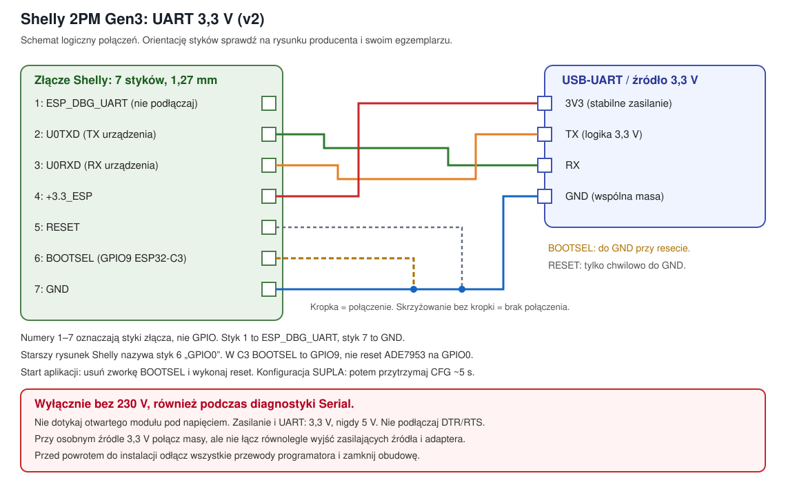

# Shelly 2PM Gen3: flashowanie i aktualizacja wariantu A v2

Ta instrukcja dotyczy **własnego szkicu v2**, nie GUI-Generic.
Start projektu: [README](../README.md).
Schemat: [UART v2](img/02-zlacze-programowania-v2.svg).

**Pierwsze przejście z Shelly na SUPLA i późniejsza aktualizacja to różne operacje.**
Pierwsze używa pełnego obrazu, aktualizacja zapisuje wyłącznie aplikację.
Nie kopiuj wszystkich bloków jako jednego skryptu.

## 0. Bezpieczeństwo

- Całkowicie odłącz moduł od instalacji 230 V, potwierdź brak napięcia i nie
  dotykaj części zasilacza, dopóki nie jest bezpiecznie rozładowany.
- **Nie łącz komputera/programatora z Shelly zasilanym z sieci.**
  Zakaz dotyczy również podglądu Serial i testów S1/S2.
- Podczas pracy na stole podawaj wyłącznie stabilne **3,3 V**.
  Sprawdź też poziom logiczny TX adaptera. Nie podawaj 5 V.
- Do uruchomienia Wi-Fi zalecane jest źródło 3,3 V o wydajności co najmniej
  500 mA. Wyjście 3V3 taniego adaptera może nie wystarczyć.
  Przy osobnym źródle łącz masy, nie łącz równolegle wyjść zasilających.
- Przed ponownym montażem odłącz wszystkie przewody UART i zamknij obudowę.
  Montaż sieciowy i testy napędu powierz elektrykowi.

## 1. Narzędzia i ustawienia terminala

Sprawdzone środowisko: `arduino-cli 1.3.1`, core `esp32:esp32 3.3.3`,
`SuplaDevice 26.8`, `esptool 5.1.0` dostarczany z core.
Nie aktualizuj przy tej samej operacji toolchaina, układu partycji ani flag
zmieniających kanały/format stanu.

Ustaw poniższe zmienne **w jednym terminalu**. Podmień `PORT` na rzeczywisty
port adaptera, znaleziony np. przez `arduino-cli board list`.

```bash
PROJECT="/Users/serwerhome/Projects/supla-esp32-base/projects/wip/shelly-2pmg3-rolety-supla"
SKETCH="$PROJECT/firmware/shelly2pmg3_roleta_v2"
BUILD="$PROJECT/firmware/build/v2"
BACKUP_DIR="$PROJECT/backups"
ESPLOADER="$HOME/Library/Arduino15/packages/esp32/tools/esptool_py/5.1.0/esptool"
PORT="/dev/cu.usbserial-XXXX"

# Ręczny BOOT/RESET, bez połączeń DTR/RTS.
esp() {
  "$ESPLOADER" --chip esp32c3 --port "$PORT" --baud 115200 \
    --before no-reset --after no-reset "$@"
}
```

Funkcja `esp` nie wykonuje resetu automatycznie. Zakończenie komendy
nie oznacza uruchomienia aplikacji. Reset wykonujesz ręcznie zgodnie z opisem.
Nie używaj `--force` do obchodzenia błędów zabezpieczeń lub zgodności obrazu.

## 2. Złącze serwisowe

Złącze ma 7 styków, raster 1,27 mm. Nie wyznaczaj orientacji przez zgadywanie
„lewej strony”. Porównaj egzemplarz z
[rysunkiem interfejsu w dokumentacji Shelly](https://kb.shelly.cloud/knowledge-base/shelly-2pm-gen3).
Styk **1 to ESP_DBG_UART**, a styk **7 to GND**.
Nasz SVG przedstawia połączenia logiczne, nie widok konkretnej strony PCB.

| Styk Shelly | Sygnał | Podłączenie |
|---|---|---|
| 1 | ESP_DBG_UART | nie podłączaj |
| 2 | U0TXD | RX adaptera |
| 3 | U0RXD | TX adaptera |
| 4 | +3.3_ESP | 3,3 V ze źródła zasilania |
| 5 | RESET | opcjonalnie chwilowo do GND |
| 6 | BOOTSEL | zworka do GND przy resecie/włączeniu zasilania |
| 7 | GND | wspólna masa źródła i adaptera |

**Uwaga na oznaczenie „GPIO0” na starszym rysunku Shelly:** odpowiada ono
funkcji BOOTSEL styku 6. W ESP32-C3 BOOTSEL jest na **GPIO9**, natomiast GPIO0
procesora służy w tym urządzeniu do resetu ADE7953. Nie zwieraj dowolnego
punktu GPIO0 zamiast styku BOOTSEL. Przycisk obudowy GPIO19 jest przyciskiem
konfiguracji aplikacji, nie BOOTSEL.



## 3. Wejście w bootloader i sprawdzenie połączenia

1. Bez jakichkolwiek połączeń do instalacji sieciowej podłącz UART i źródło 3,3 V.
2. Połącz **styk 6 (BOOTSEL) ze stykiem 7 (GND)**.
3. Włącz 3,3 V albo wykonaj krótki impuls RESET do GND.
4. Urządzenie jest w bootloaderze. Sprawdź:

```bash
esp chip-id
esp flash-id
```

Oczekiwane: ESP32-C3 i pamięć 8 MB. Przy innym wyniku **przerwij**.
Jeśli kolejna komenda nie łączy się, ponownie wykonaj ręczne wejście w bootloader.

Aby uruchomić aplikację: **usuń zworkę BOOTSEL**, a następnie wykonaj reset
albo cykl zasilania 3,3 V. Nie pozostawiaj RESET zwartego do GND.

## 4. Kopia fabrycznego firmware przed pierwszym zapisem

Ten rozdział dotyczy przejścia z Shelly na SUPLA. Dla działającej już SUPLA
wykonaj zamiast tego kopię sprzed aktualizacji z rozdziału 7.

```bash
mkdir -p "$BACKUP_DIR"
STOCK_BACKUP="$BACKUP_DIR/shelly-stock-$(date +%Y%m%d-%H%M%S).bin"
esp read-flash 0x0 0x800000 "$STOCK_BACKUP" &&
  test "$(wc -c < "$STOCK_BACKUP")" -eq 8388608 &&
  shasum -a 256 "$STOCK_BACKUP"
```

Nie zapisuj niczego do urządzenia, jeśli odczyt nie zakończył się poprawnie.
Plik musi mieć **8 388 608 bajtów**. Zachowaj kopię poza katalogiem roboczym,
przypisaną do konkretnego egzemplarza. Może zawierać hasła i dane konta:
nie publikuj jej i nie dodawaj do Git (`backups/` jest ignorowane).

Dla weryfikacji można odczytać flash drugi raz i porównać pliki, nie uruchamiając
pomiędzy odczytami fabrycznej aplikacji:

```bash
esp read-flash 0x0 0x800000 "$STOCK_BACKUP.verify.bin" &&
  cmp "$STOCK_BACKUP" "$STOCK_BACKUP.verify.bin"
```

Brak wyjścia z `cmp` i kod 0 oznaczają zgodność. Przy różnicy lub błędzie nie
przechodź do zapisu. Odczyt 8 MB przy 115200 może potrwać kilkanaście minut.

## 5. Kompilacja i pierwsze przejście na SUPLA

### Kompilacja v2

```bash
"$HOME/.local/bin/arduino-cli" compile --jobs 4 \
  --fqbn "esp32:esp32:esp32c3:FlashSize=8M,PartitionScheme=default_8MB" \
  --output-dir "$BUILD" "$SKETCH"
```

Nie kontynuuj po nieudanej kompilacji: w katalogu mogą zostać stare artefakty.
Wynikiem są m.in.:

- `shelly2pmg3_roleta_v2.ino.bin`: sama aplikacja;
- `shelly2pmg3_roleta_v2.ino.merged.bin`: pełny obraz 8 MB;
- `shelly2pmg3_roleta_v2.ino.partitions.bin`: tabela partycji.

### Pierwszy zapis, usuwa całą dotychczasową zawartość flash

**Tylko po poprawnym wykonaniu i sprawdzeniu kopii z rozdziału 4.**
Nie stosuj tego bloku do zwykłej aktualizacji SUPLA.

```bash
test -f "$STOCK_BACKUP" &&
  test "$(wc -c < "$STOCK_BACKUP")" -eq 8388608 &&
  test -f "$BUILD/shelly2pmg3_roleta_v2.ino.merged.bin" &&
  test "$(wc -c < "$BUILD/shelly2pmg3_roleta_v2.ino.merged.bin")" -eq 8388608 &&
  esp write-flash 0x0 "$BUILD/shelly2pmg3_roleta_v2.ino.merged.bin"
```

Nie jest potrzebne oddzielne `erase-flash`: esptool kasuje zapisywane sektory.
Tutaj obraz obejmuje całe 8 MB, więc **usuwa również konfigurację i dane**.
Poczekaj na poprawne zakończenie weryfikacji zapisu. Następnie usuń zworkę
BOOTSEL i wykonaj ręczny reset.

## 6. Ręczne uruchomienie konfiguracji

1. Po uruchomieniu pustego urządzenia **nie pojawia się AP automatycznie**.
2. Przytrzymaj CFG około 5 s, puść i połącz się z siecią `SUPLA…`.
3. Otwórz `http://192.168.4.1`, wpisz Wi-Fi 2,4 GHz i e-mail konta.
   Pole serwera pozostaw puste dla autodiscovery publicznej chmury albo wpisz
   dokładny adres przypisany do konta.
4. W Cloud czasowo włącz rejestrację urządzeń.
   GUID/AuthKey powstają automatycznie, panel nie wymaga ich wpisywania.
5. Zapisz ustawienia i zrestartuj przez panel lub krótkie naciśnięcie CFG.

Ponowne długie przytrzymanie CFG w konfiguracji resetuje ustawienia,
nie jest zwykłym wyjściem z panelu. Podczas konfiguracji na stole wystarczy
wydajne źródło 3,3 V. Nie podawaj 230 V razem z UART.

Czasy przejazdu ustawiasz w konfiguracji kanału SUPLA.
Wybór mono/bi: panel WWW → IN1/IN2 → MONOSTABLE/BISTABLE → zapisz i restart.

## 7. Aktualizacja v1/v2 wariantu A z zachowaniem ustawień

**Nie wykonuj pełnego kasowania i nie używaj `merged.bin`.**

Warunki tej procedury:

- urządzenie już pracuje na własnym wariancie A z tego projektu;
- układ `default_8MB`, aplikacja uruchamiana z **app0, adres `0x10000`**;
- ten sam toolchain i konfiguracja kanałów; przy przejściu v1 → v2 zachowaj
  zwłaszcza `SHELLY_TILT_FUNCTIONS`;
- nie jest to migracja z GUI-Generic, Tasmoty ani innego układu partycji.

Wariant A nie ma OTA i standardowo startuje z app0 po pierwszym wgraniu.
Jeśli później zmieniano wybór partycji startowej albo nie znasz historii
urządzenia, **zatrzymaj się i ustal aktywną partycję**. Samo porównanie tabel
partycji nie potwierdza, z której uruchamiana jest aplikacja.

1. Zatrzymaj roletę i odczekaj zapis stanu. Odłącz moduł od instalacji.
2. Skompiluj v2 zgodnie z rozdziałem 5. Nie kontynuuj po błędzie kompilacji.
3. Podłącz UART wyłącznie na stole i wejdź w bootloader.
4. Zrób pełną kopię **bieżącej SUPLA**, nie nadpisując kopii fabrycznej:

```bash
mkdir -p "$BACKUP_DIR"
UPDATE_BACKUP="$BACKUP_DIR/supla-before-update-$(date +%Y%m%d-%H%M%S).bin"
esp read-flash 0x0 0x800000 "$UPDATE_BACKUP" &&
  test "$(wc -c < "$UPDATE_BACKUP")" -eq 8388608 &&
  shasum -a 256 "$UPDATE_BACKUP"
```

Sprawdź poprawne zakończenie odczytu; dodatkowy drugi odczyt i `cmp`
można wykonać analogicznie do rozdziału 4.

5. Sprawdź zgodność tabeli partycji i zapisz **wyłącznie aplikację**.
   Łańcuch `&&` nie wykona zapisu, jeśli zabraknie backupu, odczyt się nie uda
   albo tabela będzie inna:

```bash
test -f "$UPDATE_BACKUP" &&
  test "$(wc -c < "$UPDATE_BACKUP")" -eq 8388608 &&
  test -f "$BUILD/shelly2pmg3_roleta_v2.ino.bin" &&
  esp read-flash 0x8000 0xC00 "$UPDATE_BACKUP.partitions.bin" &&
  cmp "$UPDATE_BACKUP.partitions.bin" "$BUILD/shelly2pmg3_roleta_v2.ino.partitions.bin" &&
  esp write-flash 0x10000 "$BUILD/shelly2pmg3_roleta_v2.ino.bin"
```

**Przy innej tabeli nie omijaj `cmp`.** Potrzebna jest osobna procedura migracji.
Ten zapis nie obejmuje NVS, LittleFS, tabeli partycji, bootloadera ani otadata.
Zachowuje więc zapisane Wi-Fi, GUID/AuthKey i stan, o ile nowy firmware
pozostaje zgodny z ich formatem. W v2 zachowano układ v1.

6. Po poprawnym zapisie zdejmij zworkę BOOTSEL i zresetuj urządzenie.
7. Sprawdź wersję `shelly2pmg3-v2`, ten sam GUID/kanał oraz zapisane ustawienia.
   Testy napędu wykonuj dopiero po odłączeniu UART, zamknięciu obudowy
   i bezpiecznym powrocie do instalacji.

Nie wgrywaj przy tej aktualizacji `bootloader.bin`, `partitions.bin`,
`boot_app0.bin` ani obrazu fabrycznego. Nie ma takiej potrzeby.

## 8. Przywrócenie pełnej kopii

Przywrócenie usuwa obecny firmware i ustawienia, zastępując je stanem z kopii.
Dotyczy zarówno powrotu do Shelly, jak i odtworzenia SUPLA sprzed aktualizacji.
Używaj wyłącznie kopii tego samego egzemplarza.

Po wejściu w bootloader ustaw pełną ścieżkę do właściwej, wcześniej sprawdzonej kopii:

```bash
RESTORE_BACKUP="$BACKUP_DIR/TUTAJ_NAZWA_WLASCIWEJ_KOPII.bin"
test -f "$RESTORE_BACKUP" &&
  test "$(wc -c < "$RESTORE_BACKUP")" -eq 8388608 &&
  esp write-flash 0x0 "$RESTORE_BACKUP"
```

Nie kasuj wcześniej pamięci osobną komendą. Po weryfikacji zapisu usuń
zworkę BOOTSEL i zresetuj urządzenie.
Bez własnej kopii odzyskiwanie z paczki producenta jest osobnym zadaniem,
nie równoważnym prostemu odtworzeniu wszystkich danych egzemplarza.

## 9. Co sprawdzić na sprzęcie

- ręczne wejście w AP po CFG i zwykłe uruchomienie po zapisaniu Wi-Fi;
- oba pola mono/bi, zapis i zachowanie po restarcie;
- kierunki góra/dół, STOP i przerwę przy zmianie kierunku;
- czasy ustawiane przez SUPLA i ustalenie pozycji odniesienia;
- zachowanie po zaniku zasilania;
- aktualizację bez utraty GUID, danych Wi-Fi, typu wejść i czasów.

Te testy nie zostały jeszcze wykonane na urządzeniu.

## 10. Diagnostyka

| Objaw | Sprawdzenie |
|---|---|
| Timeout esptool | ponownie BOOTSEL → GND i reset; sprawdź orientację złącza, TX/RX i GND |
| Błędy transmisji | pewne krótkie przewody, stabilne 3,3 V, baud 115200 |
| Brak portu | właściwy kabel USB i sterownik adaptera, nie każdy port nazywa się `usbserial` |
| Port zajęty | zamknij monitor portu lub inny program |
| Brak AP po zapisie | usuń BOOTSEL, uruchom aplikację, następnie przytrzymaj CFG około 5 s |
| Reset przy uruchamianiu Wi-Fi | sprawdź wydajność źródła 3,3 V |
| `cmp` wykazuje różnicę partycji | przerwij aktualizację, nie zapisuj na założony adres |
| Utracone ustawienia po aktualizacji | sprawdź, czy nie zapisano pełnego obrazu; odtwórz własny backup sprzed aktualizacji |

## 11. Który plik do czego

| Plik | Zastosowanie |
|---|---|
| `firmware/build/v2/shelly2pmg3_roleta_v2.ino.bin` | aktualizacja samej aplikacji, rozdział 7 |
| `firmware/build/v2/shelly2pmg3_roleta_v2.ino.merged.bin` | pierwsza instalacja, usuwa całą pamięć, rozdział 5 |
| `firmware/build/v2/shelly2pmg3_roleta_v2.ino.partitions.bin` | wzorzec do porównania układu partycji |
| `backups/shelly-stock-*.bin` | prywatna kopia sprzed zmiany firmware |
| `backups/supla-before-update-*.bin` | prywatna kopia działającej SUPLA sprzed aktualizacji |

Artefakty kompilacji i backupy są ignorowane przez Git.
